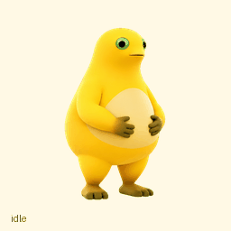

# 奶蛙桌宠 · Milk Frog

一只圆滚滚的黄色奶蛙，有奶油色肚皮、绿眼睛和棕色手脚。包含独立 Windows 桌宠、应用内宠物素材、完整源码和中文说明。



## 直接使用 Windows 桌宠

1. 下载 [Windows 便携包](downloads/MilkFrog-Windows.zip)。
2. 解压到一个文件夹。
3. 双击 `MilkFrog.exe`，让 `spritesheet.png` 和程序放在同一文件夹。

也可以下载整个仓库，打开 `windows/MilkFrog.exe`。

| 操作 | 效果 |
| --- | --- |
| 单击角色 | 挥手或轻跳，并显示一句本地短句 |
| 按住左键拖动 | 移动奶蛙 |
| 在奶蛙身上滚动滚轮 | 调整大小 |
| 右键角色 | 散步、休息、暂停、大小、隐藏和退出 |
| 双击托盘图标 | 重新显示奶蛙 |

支持透明悬浮、置顶、透明空白区域点击穿透、位置与大小记忆、单实例，以及鼠标附近的视线跟随。取消“自由散步”后，奶蛙会留在原地。

运行环境：64 位 Windows，使用 .NET Framework/WPF。本项目已在制作时的 Windows 电脑上编译和实际运行。

## 应用内素材和动画预览

下载 [应用内素材包](downloads/MilkFrog-App-Pet.zip)，或打开 `app-pet` 文件夹：

- `preview.html`：本地互动预览，切换动作并跟随鼠标视线。
- `spritesheet.png`：v2 透明动作图，1536×2288，73 帧。
- `spritesheet-v1-legacy.png`：兼容旧格式的前九行，1536×1872，57 帧。
- `all-actions.gif` / `all-actions.mp4`：全部基础动作。
- `idle-jump-idle.gif`：待机、小跳、回到待机。
- `look-around.gif`：十六个观察方向。
- `states/`：各组独立动作动画。

应用内宠物的导入方式和界面支持情况请参阅 [OpenAI 官方 Pets 说明](https://learn.chatgpt.com/docs/pets)。仓库中的素材可以备份和再次导入；本地文件不包含账号登录凭据。

## 从源码重新编译

源代码位于 `windows/src`。在 PowerShell 中运行：

```powershell
powershell -ExecutionPolicy Bypass -File .\windows\src\build.ps1
```

脚本使用 Windows 自带 .NET Framework 目录中的 C# 编译器，生成 `windows/MilkFrog.exe`。不需要 Python、Node.js 或第三方 GUI 框架。

程序使用本地透明图片逐帧播放，文字气泡是预设短句。`settings.txt` 在运行后自动生成，用于保存这台电脑的位置、大小和散步选项。

## 素材与验证

形象依据提供的参考图制作，参考图位于 `artwork/reference.png`；最终实际使用的图像生成提示词位于 `artwork/prompts`。素材使用内置 imagegen 生成，随后提取、拼接并验证，未使用手绘占位角色。

九组基础动作包括待机、向右行走、向左行走、挥手、小跳、泄气、等待、思考和检查，再加十六个观察方向。

详见 [验证记录](docs/verification.md)。四个主要观察方向通过独立复核；337.5° 接近正上方，其左向分量较弱。

桌宠交互参考：[cccc433/desktop-pet](https://github.com/cccc433/desktop-pet)。Windows 程序的 C# 源码为本项目单独编写，未复制该参考项目的实现。
